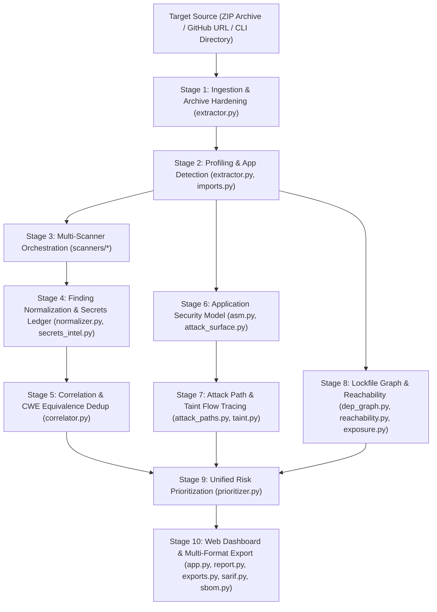

# VibeSec System Architecture & Data Flow

This document details the internal technical architecture, data-flow pipelines, trust boundaries, and component specifications of VibeSec.

---

## 1. Architectural Principles

1. **Zero Untrusted Execution Invariant**: VibeSec performs strictly static application security testing (SAST) and software composition analysis (SCA). It never imports, executes, evaluates, or builds untrusted target code.
2. **Deterministic Prioritization**: Risk scores are strictly bounded in $[0.0, 10.0]$ using a transparent CVSS-aligned multiplicative model incorporating AST call-graph reachability, deployment exposure class, authentication context, and exploit signals.
3. **Defense-in-Depth Ingestion**: Archive extraction, URL parsing, and file profiling operations are isolated from host system boundaries with streaming byte limits (up to 1 GB compressed, 50,000 members, 5 GB uncompressed), symlink skipping, and directory traversal guards.
4. **Graceful Scanner Degradation**: Absence or failure of optional external scanner binaries (e.g., Trivy, Gitleaks) records explicit `ToolStatus` states (`SKIPPED`, `DEGRADED`) and continues pipeline analysis using internal AST analyzers without aborting.
5. **Single-Scan Web Focus**: The Streamlit dashboard focuses exclusively on the active assessment with an exclusive light theme, 4 targeted sections (`Scan`, `Attack Surface & Paths`, `Dependencies`, `Reports`), and zero clutter from historical or toolchain dashboards.

---

## 2. End-to-End Pipeline Data Flow

The assessment engine operates as a deterministic 10-stage processing pipeline:

### Stage Details

1. **Stage 1: Ingestion & Archive Hardening** (`extractor.py`):
   - Validates ZIP archive integrity, enforces `MAX_ARCHIVE_BYTES` (1 GB), `MAX_ARCHIVE_MEMBERS` (50,000 entries), and `MAX_UNCOMPRESSED_BYTES` (5 GB) via streaming 64 KB chunk extraction, skips symlinks, blocks dangerous executables (`.exe`, `.dll`, `.com`, `.msi`), and rejects Zip Slip / drive-letter traversal.
   - Clones public GitHub repositories via shallow HTTPS `git clone` with direct codeload ZIP fallback.
2. **Stage 2: Profiling & Application Type Detection** (`extractor.py`, `imports.py`):
   - Detects project languages, package ecosystems, framework signatures (FastAPI, Flask, Django, Express, Next.js, React, NestJS), and application architecture (`server`, `frontend`, `cli`, `library`).
   - Dynamically ignores compiled and non-text assets (`is_binary_file`).
3. **Stage 3: Multi-Scanner Orchestration** (`scanners/*`):
   - Executes applicable scanners (Semgrep, Gitleaks, Bandit, Trivy, pip-audit, npm audit) via `scanners/base.py` with explicit `argv` arrays (`shell=False`), scrubbed environments (`get_scrubbed_env()`), telemetry disabled (`DO_NOT_TRACK=1`, `SEMGREP_SEND_METRICS=off`, `TRIVY_NO_PROGRESS=true`), 60–90 second hard timeouts, and 25 MB output capture caps.
4. **Stage 4: Finding Normalization & Secrets Hardening** (`normalizer.py`, `secrets_intel.py`, `config_exposure.py`):
   - Converts raw tool outputs into unified `Finding` dataclasses and evaluates inline `# vibesec-ignore:` suppressions.
   - Uses Python AST inspection and a string-aware JS/TS comment tokenizer to eliminate comment/docstring false positives while preserving genuine leaked credentials inside comments/docstrings and checking environment fallback literals.
   - Records suppressed and filtered findings in a transparent audit ledger.
5. **Stage 5: Correlation & Deduplication** (`correlator.py`, `owasp.py`):
   - Merges multi-scanner overlaps using proximity clustering (same file, line $\pm 2$) and canonical CWE equivalence mappings (`cwe_equivalence.yaml`) while strictly isolating dependency advisories across distinct lockfile packages. Maps CWE IDs to OWASP Top 10 (2021).
6. **Stage 6: Application Security Model** (`asm.py`, `attack_surface.py`):
   - Reconstructs HTTP routes, URL prefixes, HTTP methods, authentication boundaries (`PUBLIC` vs `AUTHENTICATED`), data stores, external API calls, and input parameter declarations.
7. **Stage 7: Attack Path & Taint Analysis** (`attack_paths.py`, `taint.py`):
   - Tracks deterministic inter-procedural taint propagation from public entrypoints to dangerous execution sinks (`taint_catalog.yaml`).
   - Enforces at least 3 traceable steps ($\text{source} \rightarrow \text{flow} \rightarrow \text{sink}$) and generates non-executable canary `curl` verification templates (`echo vibe_canary`).
8. **Stage 8: SCA Graph, Exposure, & Reachability** (`dep_graph.py`, `exposure.py`, `reachability.py`, `grouping.py`, `exploit_intel.py`, `supply_chain.py`, `license_eval.py`):
   - Classifies dependency exposure (`RUNTIME_SERVER`, `RUNTIME_BUNDLE`, `TOOLCHAIN_BUILD`, `TOOLCHAIN_DEVSERVER`, `TEST`).
   - Analyzes AST import and call sites to determine static reachability (`CALLED`, `IMPORTED`, `TRANSITIVE_OF_RUNTIME`, `NOT_IMPORTED`).
   - Queries CISA KEV and EPSS intelligence (with SQLite cache and offline fallback), detects typosquatted/hallucinated packages and npm aliases, and checks SPDX licenses against `license_policy.yaml`.
9. **Stage 9: Unified Risk Prioritization** (`prioritizer.py`):
   - Computes context-adjusted risk scores ($0.0 - 10.0$) using bounded multiplicative formulas.
   - Partitions findings into CVSS-aligned severity buckets (`CRITICAL`, `HIGH`, `MEDIUM`, `LOW`, `INFO`) and computes the authoritative executive risk posture statement.
10. **Stage 10: Web Dashboard & Multi-Format Exports** (`app.py`, `report.py`, `exports.py`, `sarif.py`, `sbom.py`, `storage.py`):
    - Renders results in the 4-tab light-theme Streamlit portal (`Scan`, `Attack Surface & Paths`, `Dependencies`, `Reports`).
    - Exports OASIS SARIF 2.1.0 (with `%SRCROOT%` relative URIs, `primaryLocationLineHash`, and step-by-step `codeFlows`), CycloneDX 1.5 JSON SBOM (with SHA-512/SHA-256 lockfile hashes, dependency graph, and VEX `in_triage` reachability properties), executive PDF (`fpdf2`), and technical Markdown. Supports optional local SQLite CLI persistence (`storage.py`).

---

## 3. Trust Boundaries

VibeSec establishes 4 formal isolation boundaries:

| Boundary | Untrusted Input | Enforcement Mechanism |
|---|---|---|
| **TB-1: Ingestion Boundary** | User-supplied ZIP archives, GitHub URLs, CLI directories | Streaming 64 KB decompression byte cap (`MAX_UNCOMPRESSED_BYTES`), Zip Slip & symlink neutralization, strict HTTPS URL regex, host path sanitization (`dir: <basename>`). |
| **TB-2: Subprocess Execution Boundary** | Scanner invocations, target source files | `shell=False`, explicit `argv` arrays, scrubbed environment variables (telemetry disabled, cloud tokens stripped), 60–90s hard timeout, 25 MB stdout/stderr cap. |
| **TB-3: Network Isolation Boundary** | Outbound API requests (EPSS, CISA KEV, registry checks) | When `VIBESEC_OFFLINE=1` or `no_network=True`, outbound network queries are disabled and intelligence relies on cached/neutral local state. |
| **TB-4: Client Export Boundary** | Exported JSON, SARIF, SBOM, PDF, and Markdown reports | Absolute host paths and temporary directory names are stripped; relative POSIX URIs under `%SRCROOT%` are enforced. |

---

## 4. Module Inventory

### Web Portal & Entrypoints
- `app.py` (repository root): Light-theme 4-tab Streamlit web dashboard (`Scan`, `Attack Surface & Paths`, `Dependencies`, `Reports`) with 1 GB streamed ZIP ingestion, real-time progress bar, Graphviz visualizers, and one-click multi-format report exports.
- `src/vibesec/cli.py`: Command-line interface (`scan`, `asm`, `paths`, `doctor`, `list`, `show`, `clear`, `bench`, `demo`) with deterministic exit codes (`0`: clean, `1`: `--fail-on` threshold breached, `2`: invalid input, `3`: execution error).

### Core Engine (`src/vibesec/`)
- `asm.py`: Application Security Model construction (routes, URL prefixes, auth states, parameters, data stores).
- `attack_paths.py`: Source-to-sink attack-path graph constructor and inert canary PoC generator.
- `attack_surface.py`: Static route detection heuristics for Flask, FastAPI, Express, and Next.js.
- `config_exposure.py`: Frontend bundle, Dockerfile, CI workflow, CORS, and configuration exposure checks.
- `correlator.py`: Multi-scanner finding proximity deduplication and CWE equivalence clustering.
- `dep_graph.py`: Lockfile dependency graph builder (`package-lock.json`, `requirements.txt`, `poetry.lock`, `Pipfile.lock`) with integrity hash parsing.
- `exploit_intel.py`: EPSS and CISA KEV exploit intelligence with SQLite caching and offline fallback.
- `exports.py`: Technical Markdown and JSON report generation (`export_markdown`, `export_json`).
- `exposure.py`: Runtime vs. toolchain vs. test exposure classification for dependencies and source files.
- `extractor.py`: Hardened archive extraction, GitHub cloning, binary filtering, and project profiling.
- `grouping.py`: Dependency FixAction upgrade planner grouped by package, version, and lockfile.
- `imports.py`: Static import analyzer shared by reachability and exposure classification.
- `license_eval.py`: SPDX license policy evaluation against `data/license_policy.yaml`.
- `models.py`: Unified dataclasses (`Finding`, `Severity`, `Location`, `ToolStatus`, `AnalysisCoverage`).
- `normalizer.py`: Scanner output normalization, AST comment/docstring FP filter, string-aware JS/TS tokenizer, and filtered findings ledger.
- `owasp.py`: CWE to OWASP Top 10 (2021) mapping.
- `pipeline.py`: End-to-end synchronous orchestrator connecting all 10 stages.
- `prioritizer.py`: Bounded 0–10 multiplicative risk scoring model and single-source-of-truth risk posture calculator.
- `reachability.py`: Static AST call-graph dependency reachability analyzer (`CALLED`, `IMPORTED`, `TRANSITIVE_OF_RUNTIME`, `NOT_IMPORTED`).
- `report.py`: Vector PDF executive security report builder (`fpdf2`).
- `sarif.py`: OASIS SARIF 2.1.0 JSON exporter with `%SRCROOT%` relative URIs, `primaryLocationLineHash`, and `codeFlows`.
- `sbom.py`: CycloneDX 1.5 JSON SBOM builder with integrity hashes, dependency graph, and VEX `in_triage` reachability analysis.
- `secrets_intel.py`: Secret intelligence, entropy/pattern analysis, and placeholder detection.
- `storage.py`: Optional SQLite persistence for CLI scan records with automatic `:memory:` fallback.
- `supply_chain.py`: Typosquatting detection, hallucinated package checks, and npm alias resolution.
- `taint.py`: Deterministic inter-procedural Python/JS AST taint flow analysis.

### External Scanner Wrappers (`src/vibesec/scanners/`)
- `base.py`: Hardened subprocess runner (`shell=False`, scrubbed environment, 60–90s timeouts, 25 MB capture cap).
- `bandit_scanner.py`: Bandit Python AST scanner wrapper.
- `gitleaks.py`: Gitleaks secret detection wrapper.
- `npm_audit.py`: `npm audit` JavaScript lockfile advisory wrapper.
- `pip_audit.py`: `pip-audit` Python lockfile advisory wrapper.
- `semgrep_scanner.py`: Semgrep SAST wrapper running default audit rules plus custom rules under `rules/vibe_code/`.
- `trivy.py`: Trivy CVE and misconfiguration scanner wrapper.
