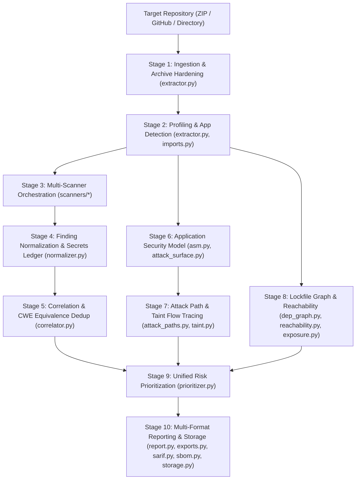

# VibeSec System Architecture & Data Flow

This document details the internal technical architecture, data-flow pipelines, trust boundaries, and component specifications of VibeSec.

---

## 1. Architectural Principles

1. **Zero Untrusted Execution Invariant**: VibeSec performs strictly static application security testing (SAST) and software composition analysis (SCA). It never imports, executes, evaluates, or builds untrusted target code.
2. **Deterministic Prioritization**: Risk scores are strictly bounded in $[0.0, 10.0]$ using a transparent multiplicative model incorporating AST call-graph reachability, deployment exposure class, authentication context, and exploit signals.
3. **Defense-in-Depth Ingestion**: All archive extraction, URL parsing, and file profiling operations are isolated from host system boundaries with streaming byte limits, symlink skipping, and directory traversal guards.
4. **Graceful Scanner Degradation**: Absence or failure of optional external scanner binaries (e.g., Trivy, Gitleaks) records explicit `ToolStatus` states (`SKIPPED`, `DEGRADED`) and continues pipeline analysis using internal AST analyzers without aborting.

---

## 2. End-to-End Pipeline Data Flow

The assessment engine operates as a sequential 10-stage processing pipeline:

### Stage Details

1. **Stage 1: Ingestion & Archive Hardening** (`extractor.py`):
   - Validates archive integrity, enforces `MAX_UNCOMPRESSED_BYTES` via streaming chunk extraction, skips symlinks, and sanitizes file paths to prevent directory traversal.
2. **Stage 2: Profiling & Application Type Detection** (`extractor.py`, `imports.py`):
   - Detects project languages, package ecosystems, framework signatures (FastAPI, Flask, Express, Next.js), and application architecture (server, frontend, CLI, library).
   - Dynamically ignores binary and non-text files (`is_binary_file`).
3. **Stage 3: Multi-Scanner Orchestration** (`scanners/*`):
   - Executes applicable scanners (Semgrep, Gitleaks, Bandit, Trivy, pip-audit, npm audit) with explicit `argv` argument lists (`shell=False`), scrubbed environments, 60–90 second timeouts, and 25 MB output memory caps.
4. **Stage 4: Finding Normalization & Secrets Hardening** (`normalizer.py`, `secrets_intel.py`):
   - Converts raw tool outputs into unified `Finding` dataclasses.
   - Preserves genuine credentials inside comments/docstrings while suppressing benign keyword mentions.
   - Records suppressed findings in a transparent audit ledger.
5. **Stage 5: Correlation & Deduplication** (`correlator.py`):
   - Merges multi-scanner overlaps using proximity clustering (same file, line $\pm 2$) and canonical CWE equivalence hierarchies while strictly isolating dependency advisories across distinct lockfile packages.
6. **Stage 6: Application Security Model** (`asm.py`, `attack_surface.py`):
   - Reconstructs HTTP routes, URL prefixes, HTTP methods, authentication state (`PUBLIC` vs `AUTHENTICATED`), and input validation handlers.
7. **Stage 7: Attack Path & Taint Analysis** (`attack_paths.py`, `taint.py`):
   - Tracks inter-procedural taint propagation from public entrypoints to dangerous execution sinks.
   - Enforces a minimum of 3 traceable steps (source $\rightarrow$ flow $\rightarrow$ sink) and synthesizes inert verification curl templates (`echo vibe_canary`).
8. **Stage 8: SCA Graph, Exposure, & Reachability** (`dep_graph.py`, `exposure.py`, `reachability.py`, `grouping.py`, `exploit_intel.py`, `supply_chain.py`, `license_eval.py`):
   - Classifies dependency exposure (`RUNTIME_SERVER`, `RUNTIME_BUNDLE`, `TOOLCHAIN_BUILD`, `TEST`).
   - Analyzes AST import and call sites to determine reachability (`CALLED`, `IMPORTED`, `TRANSITIVE_OF_RUNTIME`, `NOT_IMPORTED`).
   - Evaluates CISA KEV and EPSS intelligence with offline fallback, identifies hallucinated packages, and checks SPDX licenses.
9. **Stage 9: Unified Risk Prioritization** (`prioritizer.py`):
   - Computes context-adjusted risk scores ($0.0 - 10.0$) using bounded multiplicative formulations.
   - Partitions findings into CVSS-aligned severity buckets (CRITICAL, HIGH, MEDIUM, LOW, INFO).
10. **Stage 10: Multi-Format Reporting & Storage** (`report.py`, `exports.py`, `sarif.py`, `sbom.py`, `storage.py`):
    - Emits OASIS SARIF 2.1.0 (with step-by-step `codeFlows`), CycloneDX 1.5 JSON SBOM (with lockfile hashes and VEX reachability analysis), PDF executive summary, Developer Markdown, and SQLite persistence.

---

## 3. Trust Boundaries

VibeSec establishes 4 formal isolation boundaries:

| Boundary | Untrusted Input | Enforcement Mechanism |
|---|---|---|
| **TB-1: Ingestion Boundary** | User-supplied ZIP archives, GitHub URLs, local paths | Streaming decompression byte cap (`MAX_UNCOMPRESSED_BYTES`), Zip Slip rejection, strict HTTPS URL regex, host path sanitization (`dir: <basename>`). |
| **TB-2: Subprocess Execution Boundary** | Scanner invocations, target source files | `shell=False`, explicit `argv` arrays, scrubbed environment variables (telemetry disabled, cloud tokens stripped), 60–90s hard timeout, 25 MB stdout memory cap. |
| **TB-3: Network Isolation Boundary** | Outbound API requests (EPSS, CISA KEV, registry checks) | In offline mode (`--offline`), all socket connections are blocked; intelligence queries rely exclusively on local SQLite caches. |
| **TB-4: Client Export Boundary** | Exported JSON, SARIF, SBOM, PDF, and Markdown reports | Absolute host paths and temporary directory names are stripped; relative POSIX URIs under `%SRCROOT%` are enforced. |

---

## 4. Module Inventory

<!-- MODULE_LIST:START -->
- `asm.py`: Application Security Model (ASM) (v3).
- `attack_paths.py`: Attack-path engine (v3).
- `attack_surface.py`: Attack-surface mapper — static route detection for Flask, FastAPI, and Express.
- `cli.py`: VibeSec CLI — scan, doctor, list, show, bench, demo.
- `config_exposure.py`: Frontend bundle, infrastructure, and configuration exposure checks (Phase 3).
- `correlator.py`: Stage 5 — Finding Correlator + Dedup.
- `dep_graph.py`: Dependency graph parsing and scope propagation for Python and JavaScript.
- `exploit_intel.py`: EPSS and CISA KEV exploit intelligence with SQLite 24h caching and offline fallback.
- `exports.py`: Multi-format report exports — HTML, CSV, Markdown, JSON.
- `exposure.py`: Dependency exposure classification (v3).
- `extractor.py`: Stage 2 — Project Extractor + Profiler.
- `grouping.py`: Dependency finding grouping and FixAction calculation.
- `imports.py`: Static import discovery shared by reachability and exposure classification.
- `license_eval.py`: License policy evaluation against SPDX expressions and exposure classes.
- `models.py`: Common finding schema shared by every scanner (plan Section 3, Stage 4).
- `normalizer.py`: Stage 4 — Finding Normalizer.
- `owasp.py`: CWE → OWASP Top 10 (2021) and ASVS mapping.
- `pipeline.py`: Pipeline orchestrator — Upload → Discover → Scan → Correlate → Prioritize
- `prioritizer.py`: Stage 6 — Risk Prioritization (Scoring v3 - 0–10 Multiplicative Model).
- `reachability.py`: Reachability analysis v2 (exposure-aware).
- `report.py`: Stage 8 — PDF security report (fpdf2) (v3).
- `sarif.py`: SARIF 2.1.0 export with codeFlows for attack paths.
- `sbom.py`: SBOM (Software Bill of Materials) generation module (CycloneDX v1.5 format).
- `scanners/bandit_scanner.py`: Bandit wrapper — secondary Python-specific SAST scanner.
- `scanners/base.py`: Shared subprocess helpers and hardened execution sandbox for scanner wrappers.
- `scanners/gitleaks.py`: Gitleaks wrapper — hardcoded secrets (CWE-798).
- `scanners/npm_audit.py`: npm audit wrapper — JavaScript/TypeScript dependency vulnerability scanning.
- `scanners/pip_audit.py`: pip-audit wrapper — Python dependency vulnerability scanning.
- `scanners/semgrep_scanner.py`: Semgrep wrapper — default ruleset + the custom vibe-code rules (core contribution).
- `scanners/trivy.py`: Trivy wrapper — dependency CVEs, secrets, misconfigurations, and licenses.
- `secrets_intel.py`: Secrets intelligence module — enhanced secret analysis beyond raw Gitleaks output.
- `storage.py`: SQLite persistence for scans and findings (plan Section 4: zero-setup storage).
- `supply_chain.py`: Supply chain intelligence: Slopsquatting & hallucinated package detector.
- `taint.py`: Deterministic, static taint analysis for Python web handlers (Phase 2).
<!-- MODULE_LIST:END -->
