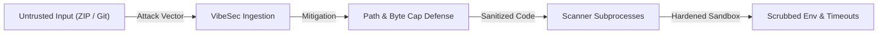

# VibeSec Threat Model

This document outlines the threat landscape, security assets, attacker profiles, defensive mitigations, and residual risks for VibeSec deployments.

---

## 1. System Assets to Protect

| Asset | Description | Impact of Compromise |
|---|---|---|
| **Host System & OS** | The operating system, filesystem, and processes hosting VibeSec. | Remote code execution, host takeover, lateral network movement. |
| **Host Credentials & Env** | Environment variables, cloud tokens, API keys, and deployment credentials on the host. | Unauthorized cloud resource access, credential exfiltration. |
| **System Resources** | Host CPU, disk space, and RAM allocated to web workers. | Resource starvation, denial-of-service (DoS) to other tenants. |
| **Analyzed Source Code** | User codebases submitted for security assessment. | Unauthorized disclosure of proprietary code or intellectual property. |
| **Scan History Database** | Stored findings and reports in SQLite (`vibesec.db`). | Leakage of discovered vulnerabilities before patches are applied. |

---

## 2. Attacker Profiles

1. **Malicious Web Uploader**: An external user submitting crafted ZIP archives to the web application.
2. **Malicious Repository Author**: An actor supplying a URL to a hostile public GitHub repository containing exploit payloads.
3. **Supply-Chain Adversary**: An actor planting malicious dependencies, scripts, or typosquatted packages in an analyzed repository.
4. **Co-located Container Tenant**: A malicious process attempting to break out of shared cloud hosting.

---

## 3. Attack Vectors & Defensive Mitigations

### Threat 1: Zip Slip & Path Traversal
- **Attack**: Archive entries containing `../`, absolute paths (`/etc/passwd`, `C:\Windows\...`), or symlinks targeting sensitive host files.
- **Mitigation**: `extractor.extract_zip` checks each canonical destination path against `dest_dir.resolve()`. Absolute paths and traversal entries raise `ExtractionError`. Symlink entries are skipped without extraction.

### Threat 2: Decompression Archive Bombs
- **Attack**: Highly compressed archives (e.g. 1 MB expanding to 50 GB) intended to exhaust host disk or memory.
- **Mitigation**: Extraction runs in streaming 64 KB chunks, maintaining a running byte counter. If extracted bytes exceed `MAX_UNCOMPRESSED_BYTES`, extraction aborts immediately and deletes partial files.

### Threat 3: Host Command Injection
- **Attack**: Maliciously crafted repository URLs, branch names, or file names containing shell metacharacters (`$(id)`, `; rm -rf /`, `| sh`).
- **Mitigation**: All subprocess invocations across `scanners/base.py` use explicit argument lists with `shell=False`. Shell interpreters (`bash`, `sh`, `cmd.exe`) are never invoked with unsanitized input. GitHub URLs are validated against a strict HTTPS regular expression.

### Threat 4: Telemetry & Credential Theft
- **Attack**: External scanner tools or third-party rules attempting to read host environment variables or transmit metrics to remote endpoints.
- **Mitigation**: `get_scrubbed_env()` strips cloud provider tokens (`AWS_*`, `AZURE_*`, `GCP_*`), API keys, and private credentials. Sets `DO_NOT_TRACK=1`, `SEMGREP_SEND_METRICS=off`, and `TRIVY_NO_PROGRESS=true`.

### Threat 5: Scanner Process Hang / Resource Exhaustion
- **Attack**: Analyzed source code engineered to trigger catastrophic backtracking (ReDoS) or infinite loops in AST parsers.
- **Mitigation**: Subprocess execution enforces strict 60–90 second timeouts with process termination (`proc.kill()`). Stdout and stderr captures are hard-capped at 25 MB to prevent out-of-memory errors.

### Threat 6: Data Exfiltration via Network Queries
- **Attack**: Scanners or analyzers querying external services to resolve package data, potentially leaking scanned package names.
- **Mitigation**: In offline mode (`--offline`), outbound network sockets are blocked. Vulnerability lookups rely strictly on pre-cached local databases.

---

## 4. Production Deployment & Defense-in-Depth Best Practices

1. **Containerized Unprivileged Execution**: Run VibeSec inside an unprivileged container (`UID 1000`) with a read-only root filesystem and ephemeral tmpfs workspace (as provided in the project `Dockerfile`).
2. **Reverse Proxy & Concurrency Throttling**: When hosting the web portal in high-throughput environments, front the Streamlit service with a reverse proxy (e.g., NGINX, Cloudflare) configured with rate limiting and connection pooling.
3. **Defense-in-Depth Observability**: Pair VibeSec's deterministic static analysis and reachability modeling with runtime monitoring or cloud security telemetry for comprehensive defense-in-depth coverage.
4. **Architectural Threat Modeling Integration**: Seamlessly pipe VibeSec's automated ASM routes, attack paths, and CycloneDX 1.5 JSON SBOMs into organizational security reviews and CI/CD pipelines.
